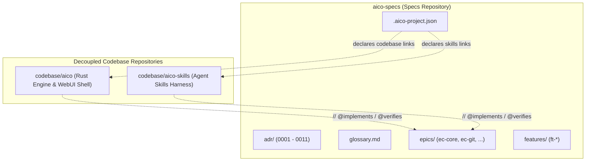

# AICO Specifications (`aico-specs`)

<!-- @implements spec-ft-repo-documentation-and-readmes::TASK-DOC-001-1::REQ-001::REQ-003 -->

> The canonical Spec-Driven Development (SDD) source of truth, architectural governance, and requirements catalog for the AICO platform.

`aico-specs` is the centralized, decoupled specification repository of the **AICO (Autonomous Intelligent Code Orchestrator)** ecosystem. It maintains formal Architecture Decision Records (ADRs), multi-feature engineering epics, standalone feature specifications, active task graphs (DAGs), and the canonical ubiquitous domain glossary.

---

## 1. The Decoupled SDD Philosophy

In traditional software development and naive AI agent setups, specifications and code are conflated in a single repository. AICO enforces a **Decoupled Repository Architecture** (ratified in [ADR-0002](adr/0002-decoupled-sdd-and-codebase-repositories.md) and [ADR-0008](adr/0008-unified-root-discovery-and-project-manifest.md)):



### Why Decoupled Specifications?
1. **Single Source of Truth Across Multiple Codebases**: A single architecture initiative often touches multiple independent repositories (e.g., the Rust runtime daemon, frontend client, mobile bridge, and agent skill packages). Decoupling keeps specifications unified without git submodule tangles.
2. **Deterministic Agent Guardrails**: Autonomous coding agents must never modify architectural intent and implementation code in the same unreviewed step. Decoupling creates an explicit structural boundary between **planning/scoping** and **code execution**.
3. **Traceability Without Clutter**: Source code and unit tests annotate public symbols and test assertions with `@implements` and `@verifies` tags that point directly back to formal requirements declared here.

---

## 2. Repository Structure

```
aico-specs/
├── .aico-project.json    # Project manifest declaring linked codebase repositories
├── glossary.md           # Canonical ubiquitous domain language & terminology
├── adr/                  # Architecture Decision Records (immutable governance)
│   ├── 0001-host-runtime-and-network-topology.md
│   ├── 0002-decoupled-sdd-and-codebase-repositories.md
│   ├── ...
│   └── 0011-aico-graph-store-and-lancedb-hybrid-storage.md
├── epics/                # Multi-feature engineering epics
│   ├── ec-core/          # Core runtime daemon, WebUI shell & workspace graph
│   ├── ec-git/           # Multi-repo Git sync, commit automation & dashboard cards
│   ├── ec-specs/         # Blueprint standards, migration & verification
│   ├── ec-storage/       # AicoGraphStore, LanceDB vector store & hybrid search
│   ├── ec-terminal/      # ConPTY/xterm.js web terminal & AI quota monitor
│   └── ec-tooling/       # Tooling, CLI harnesses & verification scripts
└── features/             # Standalone cross-cutting features
    ├── ft-fast-trace/
    └── ft-repo-documentation-and-readmes/
```

---

## 3. Epics Catalog

| Epic | Title | Focus Area | Status |
| :--- | :--- | :--- | :--- |
| **[`ec-core`](epics/ec-core/brain-ec-core.md)** | Core Architecture & Local-First Platform | Axum host server, WebUI shell layout, Project Switcher, and interactive SVG lineage graph canvas. | Active |
| **[`ec-git`](epics/ec-git/brain-ec-git.md)** | Multi-Repository Git Synchronization | Multi-repo telemetry, state-aware action buttons, and one-click AI conventional commits. | Active |
| **[`ec-specs`](epics/ec-specs/brain-ec-specs.md)** | SDD Blueprint Standards & Verification | Blueprint v0.1.2 compliance, frontmatter schema validation, and relative link enforcement. | Active |
| **[`ec-storage`](epics/ec-storage/brain-ec-storage.md)** | Dual Embedded Storage & Hybrid Search | Zero-daemon `AicoGraphStore` (property graph) and `LanceDbVectorStore` (vector embeddings). | Active |
| **[`ec-terminal`](epics/ec-terminal/brain-ec-terminal.md)** | Interactive Terminal, Quotas & Human Gates | In-browser ConPTY/xterm.js streaming terminal sessions and AI quota monitoring. | Active |
| **[`ec-tooling`](epics/ec-tooling/brain-ec-tooling.md)** | Developer Tooling & Verification CLI | Automated artifact integrity verification and AST trace extractors. | Active |

---

## 4. AICO Blueprint v0.1.2 Standards

All specifications and plans in this repository strictly adhere to **Blueprint v0.1.2** guidelines:

1. **Decoupled YAML Frontmatter**:
   Every artifact begins with standardized metadata:
   ```yaml
   ---
   id: spec-ft-feature-name
   type: spec
   aico_skills_version: "0.1.2"
   epic: "ec-core" # or null for standalone features
   order: 1
   title: "Feature Title"
   status: "Completed" # Draft | Pending | In Progress | Completed
   derives_from: ["brain-ec-core", "ADR-0004"]
   created_at: "2026-10-25T19:00:00.000Z"
   ---
   ```
2. **Strict EARS Requirements Syntax**:
   All functional requirements are formulated using one of the five Easy Approach to Requirements Syntax patterns:
   - **Ubiquitous**: *The `<system>` shall `<action>`.*
   - **Event-Driven**: *When `<trigger>`, the `<system>` shall `<action>`.*
   - **State-Driven**: *While `<state>`, the `<system>` shall `<action>`.*
   - **Optional**: *Where `<feature>`, the `<system>` shall `<action>`.*
   - **Complex**: *While `<state>`, when `<trigger>`, the `<system>` shall `<action>`.*
3. **Strict Relative Linking**:
   All internal Markdown links must be relative paths within the workspace. Absolute file system schemas (`file:///`) are strictly prohibited to ensure portability across workstations and continuous integration environments.
4. **Vertical Tracer-Bullet DAG Plans**:
   Task plans are structured as Directed Acyclic Graphs (DAGs) of vertical, end-to-end slices with explicit blocking dependencies (`Blocked by`), verifiable seams, and deliverables.

---

## 5. Artifact Verification & Tooling

To verify that all artifacts across `aico-specs` comply with Blueprint v0.1.2 standards and maintain complete link integrity, execute:

```bash
# Run verification from workspace root
node .agents/skills/aico-verify/scripts/verify-artifacts.mjs d:/aico/aico-specs
```

The verification script audits:
- **Axis 1 (Blueprint Conformance)**: Validates required frontmatter keys, schema ordering, relative links, and non-empty requirement statements.
- **Axis 2 (Ground-Truth Parity)**: Verifies that `@implements` and `@verifies` tags in code repositories match active requirement IDs declared in specifications.

---

## 6. Linked Repositories

- **Engine Codebase**: [`codebase/aico`](https://github.com/Lexer727/aico) — Rust runtime daemon, Axum server, and React WebUI shell.
- **Agent Skills**: [`codebase/aico-skills`](https://github.com/Lexer727/aico-skills) — Spec-Driven Development skills and harness for autonomous coding agents.
