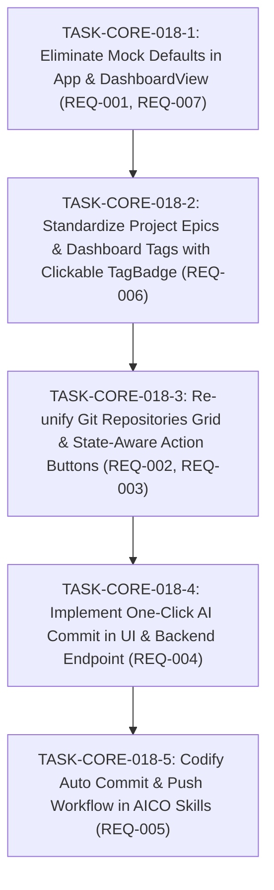

# Implementation Plan: Dashboard Workspace Refinement, Re-unified Repositories Grid & Workflow Automation

## 1. Technical Architecture & Decisions

- **Zero-Mock Initialization**: Remove static `mockProjects` in `App.tsx` and `defaultEpics` in `DashboardView.tsx`. Replace fallback mock counts with clean `0` and empty indicators to prevent misleading data flashes during page reload.
- **Re-unified Repositories Layout**: Remove the isolated "Specs Repository" section from `GitRepositoriesCard.tsx` that left 2 empty grid columns. Merge all repositories into a single responsive 3-column grid (`grid-cols-1 md:grid-cols-3 gap-3`), rendering the Specs repo (`type: 'specs'`) first, followed by codebase and skills repos.
- **State-Aware Git Buttons**:
  - Pull: Disabled when `behind === 0`; enabled with `Pull (${repo.behind})` badge when `behind > 0`.
  - Push: Disabled when `ahead === 0`; enabled with `Push (${repo.ahead})` badge when `ahead > 0`.
  - Commit: Disabled when `repo.is_clean` is true; enabled with `Commit (${modifiedCount})` when modified/untracked files exist.
- **One-Click AI Commit Action**:
  - Expose `POST /api/v1/git/ai-commit` in `crates/aico-server` which examines git diff / status, formulates a conventional commit message (e.g. `feat(<scope>): ...`), and executes the commit.
  - In `GitRepositoriesCard.tsx`, clicking `Commit` directly triggers this AI commit endpoint with spinner feedback without manual text input.
- **Tag Standardization**: Replace the bulky `Open Epic` button with the interactive `<TagBadge id={epic.id} onClick={() => onOpenEpic(epic.id)} />` in `DashboardView.tsx`.
- **Workflow Automation in Skills**: Update `aico-implementation`, `aico-review-loop`, and `aico-git` skill definitions to codify automatic staging, commit, and push across decoupled repositories upon successful task verification.

---

## 2. Task Graph (DAG)

### Phase 1: Zero-Mock Initialization & Header Cleanup

- **TASK-CORE-018-1**: Eliminate Hardcoded Mock Defaults in App & DashboardView
  - **Status**: Done
  - **Addresses**: `REQ-001`, `REQ-007`
  - **Blocked by**: None
  - **What it delivers**:
    - Removes hardcoded `Root: d:/aico/aico-specs` from `Workspace Overview` header in `DashboardView.tsx`.
    - Removes `mockProjects` in `App.tsx`, initializing `projects` with `[]`.
    - Removes `defaultEpics` from `DashboardView.tsx`, binding `activeEpics` directly to `epics`.
    - Displays clean `0` and empty state indicators instead of flashing fabricated numbers.
  - **Verification Seam**: `frontend/tests/DashboardView.test.tsx`

---

### Phase 2: Tag Navigation Standardization

- **TASK-CORE-018-2**: Standardize Project Epics & Dashboard Tags with Clickable TagBadge
  - **Status**: Done
  - **Addresses**: `REQ-006`
  - **Blocked by**: `TASK-CORE-018-1`
  - **What it delivers**:
    - Replaces the `Open Epic` button and static epic ID tag in `DashboardView.tsx` with `<TagBadge id={epic.id} onClick={() => onOpenEpic(epic.id)} />`.
    - Ensures tags have `cursor-pointer`, hover styling, and tab-opening navigation.
    - Updates test suites to reflect `TagBadge` epic interactions.
  - **Verification Seam**: `frontend/tests/DashboardView.test.tsx`

---

### Phase 3: Repositories Grid Re-unification & State Telemetry

- **TASK-CORE-018-3**: Re-unify Git Repositories Grid & State-Aware Action Buttons
  - **Status**: Done
  - **Addresses**: `REQ-002`, `REQ-003`
  - **Blocked by**: `TASK-CORE-018-2`
  - **What it delivers**:
    - Re-unifies `specs` and `codebase` repositories in `GitRepositoriesCard.tsx` into a single 3-column responsive grid with Specs repo first.
    - Eliminates empty column gaps.
    - Implements smart disabled states and count badges:
      - Pull disabled on `behind === 0` with tooltip; enabled on `behind > 0` with `Pull (${behind})`.
      - Push disabled on `ahead === 0` with tooltip; enabled on `ahead > 0` with `Push (${ahead})`.
      - Commit disabled on clean working tree with tooltip; enabled on modified tree with `Commit (${count})`.
  - **Verification Seam**: `frontend/tests/DashboardGitStatus.test.tsx` and `frontend/src/features/dashboard/__tests__/GitRepositoriesCard.test.tsx`

---

### Phase 4: One-Click AI Commit

- **TASK-CORE-018-4**: Implement One-Click AI Commit in UI & Backend Endpoint
  - **Status**: Done
  - **Addresses**: `REQ-004`
  - **Blocked by**: `TASK-CORE-018-3`
  - **What it delivers**:
    - Implements `POST /api/v1/git/ai-commit` in `crates/aico-server` generating conventional commit message from git status/diff and committing.
    - Connects `Commit` button in `GitRepositoriesCard.tsx` to directly trigger AI commit with spinner feedback without manual text input dialog.
  - **Verification Seam**: `crates/aico-server/tests/server_test.rs` and `frontend/src/features/dashboard/__tests__/GitRepositoriesCard.test.tsx`

---

### Phase 5: Workflow Automation in AICO Skills

- **TASK-CORE-018-5**: Codify Auto Commit & Push Workflow in AICO Skills
  - **Status**: Done
  - **Addresses**: `REQ-005`
  - **Blocked by**: `TASK-CORE-018-4`
  - **What it delivers**:
    - Updates `aico-implementation/SKILL.md`, `aico-review-loop/SKILL.md`, and `aico-git/SKILL.md` (and mirrored in `.agents/skills`).
    - Mandates that upon turning red tests green and verifying artifacts, the autonomous agent automatically stages, commits, and pushes across affected repositories (`aico` and `aico-specs`).
  - **Verification Seam**: `verify-artifacts.mjs`

---

## 3. Amendment Log

- **2026-10-24T01:20:00Z**: Initialized plan for `ft-core-dashboard-and-repo-card-refinement` covering zero-mock defaults, re-unified repositories grid, state-aware git telemetry, one-click AI commit, and skills workflow auto commit/push.
