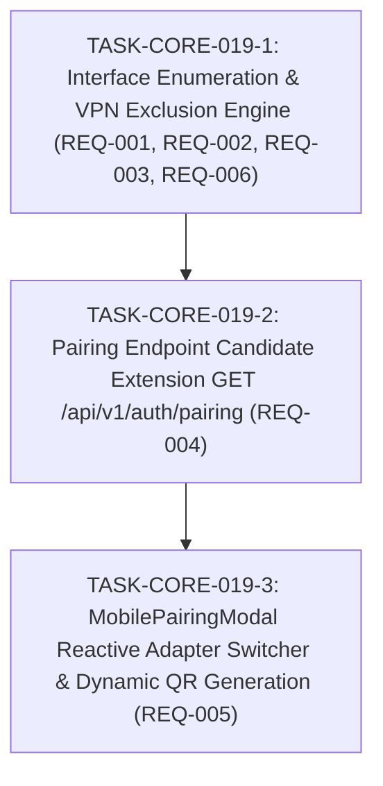

# Implementation Plan: Local LAN IP Resolution, VPN Adapter Exclusion & Multi-Interface Pairing

## 1. Technical Architecture & Decisions

- **Target repository**: `aico`.
- **Interface Enumeration & VPN Exclusion Engine**:
  - Add `get_if_addrs = "0.5"` to `crates/aico-server/Cargo.toml`.
  - In `crates/aico-server/src/server.rs`, implement `detect_lan_ip_candidates()`:
    1. Inspect `std::env::var("AICO_LAN_IP")`. If present and valid IPv4, return it as the single preferred candidate.
    2. Query `get_if_addrs::get_if_addrs()`. For each interface, extract IPv4 addresses.
    3. Exclude loopback addresses (`127.0.0.0/8`) and link-local addresses (`169.254.0.0/16`).
    4. Categorize interface names against virtual/VPN patterns (case-insensitive substring match):
       `["vpn", "proton", "wireguard", "nord", "tailscale", "tun", "tap", "vethernet", "wsl", "vbox", "virtualbox", "vmware", "docker", "bridge", "bluetooth", "loopback", "dummy"]`.
    5. Prioritize interfaces into ranked tiers:
       - Tier 1: Non-VPN Class C private (`192.168.0.0/16`).
       - Tier 2: Non-VPN Class A private (`10.0.0.0/8`).
       - Tier 3: Non-VPN Class B private (`172.16.0.0/12`).
       - Tier 4: Other non-VPN IPv4 addresses.
       - Tier 5: VPN/virtual adapter addresses (retained as secondary candidates).
    6. If no candidates are found, fall back to outbound UDP connect probe (`8.8.8.8:80`), and finally `"127.0.0.1"`.
- **Pairing API Data Model Extension**:
  - Define `LanCandidate` struct in `crates/aico-server/src/server.rs`:
    ```rust
    #[derive(Debug, Clone, Serialize, Deserialize, PartialEq, Eq)]
    pub struct LanCandidate {
        pub ip: String,
        pub interface_name: String,
        pub is_preferred: bool,
    }
    ```
  - Extend `PairingResponse`:
    ```rust
    #[derive(Debug, Clone, Serialize, Deserialize, PartialEq, Eq)]
    pub struct PairingResponse {
        pub lan_ip: String,
        pub port: u16,
        pub token: String,
        pub pairing_url: String,
        pub candidate_ips: Vec<LanCandidate>,
    }
    ```
  - Update `get_pairing_handler` in `server.rs` to compute candidates and serialize `candidate_ips`.
- **Interactive Network Adapter Selector in MobilePairingModal**:
  - Update `MobilePairingModal.tsx` and its `PairingData` interface to receive `candidate_ips: LanCandidate[]`.
  - Maintain a local state `selectedIp`, initialized to `pairingData.lan_ip`.
  - When `candidate_ips.length > 1`, render a compact select element (`data-testid="network-interface-select"`) allowing the developer to switch adapters.
  - Dynamically recalculate `fullUrl` whenever `selectedIp` changes and regenerate the SVG QR code and copy input.

---

## 2. Task Graph (DAG)



---

## 3. Tasks Breakdown

### Phase 1: Server Interface Enumeration & Ranking

- **TASK-CORE-019-1**: Cross-Platform Network Interface Enumeration & VPN Exclusion Engine
  - **Status**: Done
  - **Addresses**: `REQ-001`, `REQ-002`, `REQ-003`, `REQ-006`
  - **Blocked by**: None (Can start immediately)
  - **What it delivers**:
    - Adds `get_if_addrs = "0.5"` to `crates/aico-server/Cargo.toml`.
    - Implements `detect_lan_ip_candidates()` in `crates/aico-server/src/server.rs` with `AICO_LAN_IP` override, case-insensitive VPN/virtual adapter exclusion, and RFC 1918 priority ranking.
    - Updates `get_lan_ip()` to use the top-ranked preferred candidate.
  - **Verification Seam**: `crates/aico-server/tests/auth_test.rs`

### Phase 2: Pairing API Payload Extension

- **TASK-CORE-019-2**: Pairing Endpoint Candidate Extension (`GET /api/v1/auth/pairing`)
  - **Status**: Done
  - **Addresses**: `REQ-004`
  - **Blocked by**: `TASK-CORE-019-1`
  - **What it delivers**:
    - Defines `LanCandidate` struct and updates `PairingResponse` to include `candidate_ips: Vec<LanCandidate>`.
    - Updates `get_pairing_handler` in `crates/aico-server/src/server.rs` to return `candidate_ips`.
  - **Verification Seam**: `crates/aico-server/tests/auth_test.rs` and `crates/aico-server/tests/server_test.rs`

### Phase 3: Mobile Pairing Modal UI Switcher

- **TASK-CORE-019-3**: MobilePairingModal Reactive Adapter Switcher & Dynamic QR Generation
  - **Status**: Done
  - **Addresses**: `REQ-005`
  - **Blocked by**: `TASK-CORE-019-2`
  - **What it delivers**:
    - Updates `MobilePairingModal.tsx` to display an interface switcher dropdown if `candidate_ips.length > 1`.
    - Re-renders QR SVG and updates copy input whenever an interface is selected.
    - Adds tests verifying multi-interface selection and dynamic QR generation in `frontend/tests/MobilePairingAndSync.test.tsx`.
  - **Verification Seam**: `frontend/tests/MobilePairingAndSync.test.tsx`
