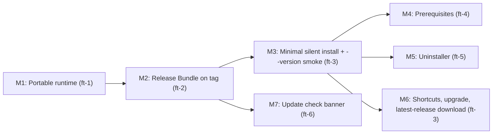

# Brainstorm: AICO Distribution: Installer, Release Pipeline & Portable Runtime

## 1. Executive Summary & Problem Statement

AICO can currently only be run from a developer checkout. There is no way for an end user to obtain, install, update, or remove it. This epic delivers a complete distribution chain:

1. A **portable runtime** that discovers its AICO Root relative to its own executable and ships its own skills bundle.
2. A **tag-driven GitHub Actions release pipeline** producing a verified Release Bundle and installer.
3. A **Windows hybrid installer** (Inno Setup 6) that prompts for the AICO Root, creates the canonical layout (`specs/`, `codebase/`, `.agents/`, `.aico/`), installs binaries into `<root>/.aico/bin`, provisions prerequisites, and offers a desktop shortcut.
4. A **scoped uninstaller** inside `.aico/bin`.
5. An optional **update check** surfaced in the WebUI.

**Measurable outcome**: On a clean Windows machine, a user downloads `aico-setup-<version>.exe`, selects a root, launches AICO, sees the WebUI at `http://localhost:4242/` and the MCP endpoint at `/mcp`, and can uninstall it leaving `specs/`, `codebase/`, and `.aico/storage` intact. The developer can run the same installer against `d:/aico` and keep the existing storage.

Architectural alignment: [ADR-0006](../../adr/0006-packaging-aico-specs-and-version-tagging.md), [ADR-0008](../../adr/0008-unified-root-discovery-and-project-manifest.md), [ADR-0012](../../adr/0012-distribution-github-releases-and-hybrid-installer.md).

---

## 2. Investigation Findings (Brownfield Blockers)

| # | Finding | Location (repo `aico`) | Resolution Feature |
| :--- | :--- | :--- | :--- |
| F1 | Root resolution falls back to hard-coded `d:/aico`, then `../..`, then cwd | `crates/aico-server/src/main.rs` | `ft-distribution-portable-runtime-root` |
| F2 | Skills sync source is exclusively `<root>/codebase/aico/skills` (submodule) | `crates/aico-core/src/skills_sync.rs` | `ft-distribution-portable-runtime-root` |
| F3 | Disk-based frontend asset lookup (cwd-relative) takes precedence over embedded assets | `crates/aico-server/src/assets.rs` | `ft-distribution-portable-runtime-root` |
| F4 | Hard-coded `d:/aico/aico-specs` specs fallback | `crates/aico-server/src/assets.rs` | `ft-distribution-portable-runtime-root` |
| F5 | Banner version hard-coded as `0.1.1` | `crates/aico-server/src/main.rs` | `ft-distribution-portable-runtime-root` |
| F6 | No `.github/workflows`, no release build | repository root | `ft-distribution-release-pipeline` |
| F7 | `~/.aico/config.json` (User Config Home) is distinct from `<root>/.aico` (AICO Home) | `crates/aico-core/src/github.rs` | glossary + `ft-distribution-uninstaller` |
| F8 | `gh` missing on the developer machine; `winget` available | host environment | `ft-distribution-prerequisite-provisioning` |

---

## 3. Explored Approaches & Trade-Off Analysis

### 3.1 Distribution Channel

| Approach | Pros | Cons | Verdict |
| :--- | :--- | :--- | :--- |
| Self-hosted download server | Full control, private binaries | Hosting cost, maintenance, TLS, uptime | **Rejected** |
| GitHub Releases (public repo) | Free CDN, stable `latest/download` URL, integrated with Actions | Public binaries, API rate limits | **Chosen** |
| Separate public releases repo | Keeps source private | Cross-repo token plumbing | Rejected (source is public) |

### 3.2 Delivery Model

| Approach | Pros | Cons | Verdict |
| :--- | :--- | :--- | :--- |
| Web-only bootstrapper | Always latest, tiny | Requires network; fragile | Rejected |
| Offline installer per release | Deterministic, offline | Users must re-download installer per version | Rejected |
| **Hybrid** (bundled payload + latest-release check) | Works offline, upgrades opportunistically | Slightly more installer logic | **Chosen** |

### 3.3 Installer Technology

| Approach | Pros | Cons | Verdict |
| :--- | :--- | :--- | :--- |
| **Inno Setup 6** | Native wizard, directory picker, task checkboxes, built-in download page, Pascal scripting, uninstaller relocatable to `.aico/bin`, CI-buildable | Pascal script dialect | **Chosen** |
| Custom Rust GUI installer | Shared Rust code | Hand-written elevation, shortcuts, registry, uninstaller | Rejected |
| PowerShell bootstrap | Simple | No wizard/checkbox UX | Deferred as secondary channel |
| WiX / MSI | Enterprise standard | Heavy; per-machine model mismatches `<root>/.aico/bin` | Rejected |

---

## 4. Core Architectural Decisions

1. **Install Mode**: Per-user, no administrator elevation. Default AICO Root: `%USERPROFILE%\aico`.
2. **AICO Root Resolution Order**: `--root` → `AICO_ROOT` → executable-relative (`<root>/.aico/bin/aico-server.exe`) → nearest ancestor of cwd containing `.aico/` → cwd. No hard-coded absolute paths.
3. **Skills Source Order**: `<root>/codebase/aico/skills` (developer submodule, if it contains skills) → `<exe_dir>/skills` (bundled with the release).
4. **Release Bundle**: `aico-windows-x64.zip` containing `aico-server.exe`, `skills/`, `prerequisites.json`, `manifest.json`; plus `aico-windows-x64.zip.sha256` and `aico-setup-<version>.exe`.
5. **Prerequisite Catalog**: Data-driven `prerequisites.json` (Git required; GitHub CLI, Node.js LTS default-checked; Claude Code, Antigravity, OpenAI Codex CLI, GitHub Copilot CLI optional). Installed via `winget` with catalog fallbacks.
6. **Uninstall Boundary**: Remove `.aico/bin`, shortcuts, PATH entry, registry key. Opt-in removal of `.aico/storage`, `.aico/logs`, `.agents/skills/aico-*`. Never remove `specs/`, `codebase/`, `~/.aico`, or prerequisites.
7. **Code Signing**: Deferred; SmartScreen warnings accepted for v1.

---

## 5. Epic Decomposition (Child Features)

| Order | Feature | Delivers |
| :--- | :--- | :--- |
| 1 | [ft-distribution-portable-runtime-root](features/ft-distribution-portable-runtime-root/spec-ft-distribution-portable-runtime-root.md) | Executable-relative root discovery, bundled skills fallback, embedded-only assets, `--version`, logs directory |
| 2 | [ft-distribution-release-pipeline](features/ft-distribution-release-pipeline/spec-ft-distribution-release-pipeline.md) | Packaging script, manifest, checksum, tag-driven GitHub Release workflow |
| 3 | [ft-distribution-windows-installer](features/ft-distribution-windows-installer/spec-ft-distribution-windows-installer.md) | Inno Setup wizard, root picker, layout, shortcuts, PATH, upgrade, latest-release download |
| 4 | [ft-distribution-prerequisite-provisioning](features/ft-distribution-prerequisite-provisioning/spec-ft-distribution-prerequisite-provisioning.md) | Prerequisite Catalog, detection, winget provisioning |
| 5 | [ft-distribution-uninstaller](features/ft-distribution-uninstaller/spec-ft-distribution-uninstaller.md) | Scoped uninstaller with opt-in storage removal |
| 6 | [ft-distribution-update-check](features/ft-distribution-update-check/spec-ft-distribution-update-check.md) | Update-check API and WebUI banner |

### Cross-Feature Tracer-Bullet Milestones

**Tracer bullet (M1 → M3)**: push tag `v0.2.0` → CI publishes Release → silent install into a temporary root on the CI runner → `aico-server.exe --version` exits 0.

---

## 6. Risks & Open Questions

- **SmartScreen**: Unsigned installer warning; signing deferred.
- **Build duration**: LanceDB release builds on `windows-latest` may take 20–30 minutes; mitigated with `Swatinem/rust-cache`.
- **winget identifiers**: Exact package IDs and npm fallbacks (Claude Code, Antigravity, Codex CLI, Copilot CLI) must be verified during implementation; they are data in the catalog and correctable without code changes.
- **File locks**: A running `aico-server.exe` locks its binary and LanceDB files; installer and uninstaller must stop it first.
