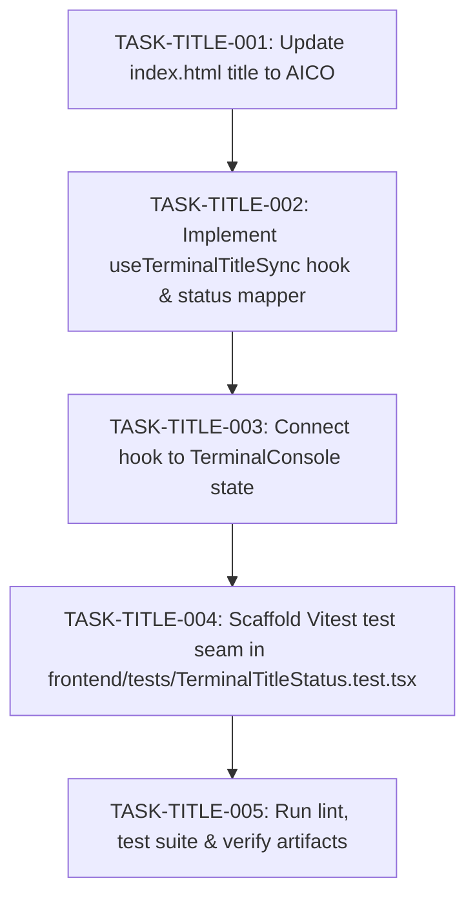

# Implementation Plan: Browser Tab Title Terminal AI Status Indicator

## 1. Technical Architecture & Decisions

- **Ambient Document Title Synchronization**:
  - Encapsulate the title calculation and animation interval in a dedicated React hook `useTerminalTitleSync` located in `frontend/src/hooks/useTerminalTitleSync.ts`.
  - Accept `tabs: TerminalTab[]` and `aiTabStatuses: Record<string, AiTabStatus>`.
  - Identify whether Antigravity (`shell: 'agy'`) and/or Claude Code (`shell: 'claude'`) tabs are present.
  - If neither is present, set `document.title = 'AICO'`.
- **Status Glyph Representation**:
  - `finished`: `🟢`
  - `waiting_for_input`: `🔵`
  - `error`: `🔴`
  - `working`: Rotating Unicode braille frame (`['⠋', '⠙', '⠹', '⠸', '⠼', '⠴', '⠦', '⠧', '⠇', '⠏']`).
- **Interval Management**:
  - Run an 80ms `setInterval` only when at least one open AI terminal has status `working`.
  - When no open terminal is `working`, dispose the interval and avoid unnecessary re-renders or background CPU consumption.
  - Restore `document.title = 'AICO'` on unmount.
- **Fixed Priority Sequencing**:
  - When both are present: `AICO <agy_glyph> <claude_glyph>`.
  - When only one is present: `AICO <glyph>`.

---

## 2. Task Graph (DAG)

### Phase 1: Core Vertical Tracer Bullet

- **TASK-TITLE-001**: Update static index.html title to AICO
  - **Status**: Done
  - **Addresses**: `REQ-001`
  - **Blocked by**: None (Can start immediately)
  - **What it delivers**:
    - Replaces `<title>frontend</title>` with `<title>AICO</title>` in `frontend/index.html`.
  - **Verification Seam**: `frontend/tests/TerminalTitleStatus.test.tsx`

- **TASK-TITLE-002**: Implement useTerminalTitleSync hook & status mapper
  - **Status**: Done
  - **Addresses**: `REQ-002`, `REQ-003`, `REQ-004`, `REQ-005`
  - **Blocked by**: `TASK-TITLE-001`
  - **What it delivers**:
    - Creates `frontend/src/hooks/useTerminalTitleSync.ts` containing the title calculation engine, braille animation loop, and cleanup handlers.
  - **Verification Seam**: `frontend/tests/TerminalTitleStatus.test.tsx`

- **TASK-TITLE-003**: Connect hook to TerminalConsole state
  - **Status**: Done
  - **Addresses**: `REQ-006`
  - **Blocked by**: `TASK-TITLE-002`
  - **What it delivers**:
    - Integrates `useTerminalTitleSync(tabs, aiTabStatuses)` into `frontend/src/components/terminal/TerminalConsole.tsx`.
  - **Verification Seam**: `frontend/tests/TerminalTitleStatus.test.tsx`

- **TASK-TITLE-004**: Scaffold Vitest test seam in frontend/tests/TerminalTitleStatus.test.tsx
  - **Status**: Done
  - **Addresses**: `REQ-001`, `REQ-002`, `REQ-003`, `REQ-004`, `REQ-005`, `REQ-006`
  - **Blocked by**: `TASK-TITLE-003`
  - **What it delivers**:
    - Complete unit tests asserting baseline title, single/dual AI terminal configurations, transitions across all 4 AI states, braille animation intervals, and timer cleanup on unmount.
  - **Verification Seam**: `frontend/tests/TerminalTitleStatus.test.tsx`

- **TASK-TITLE-005**: Run lint, test suite & verify artifacts
  - **Status**: Done
  - **Addresses**: `REQ-001`, `REQ-002`, `REQ-003`, `REQ-004`, `REQ-005`, `REQ-006`
  - **Blocked by**: `TASK-TITLE-004`
  - **What it delivers**:
    - Validates zero test regressions via `npm run test` and zero TypeScript build errors via `npm run build`.
  - **Verification Seam**: `frontend/tests/TerminalTitleStatus.test.tsx`