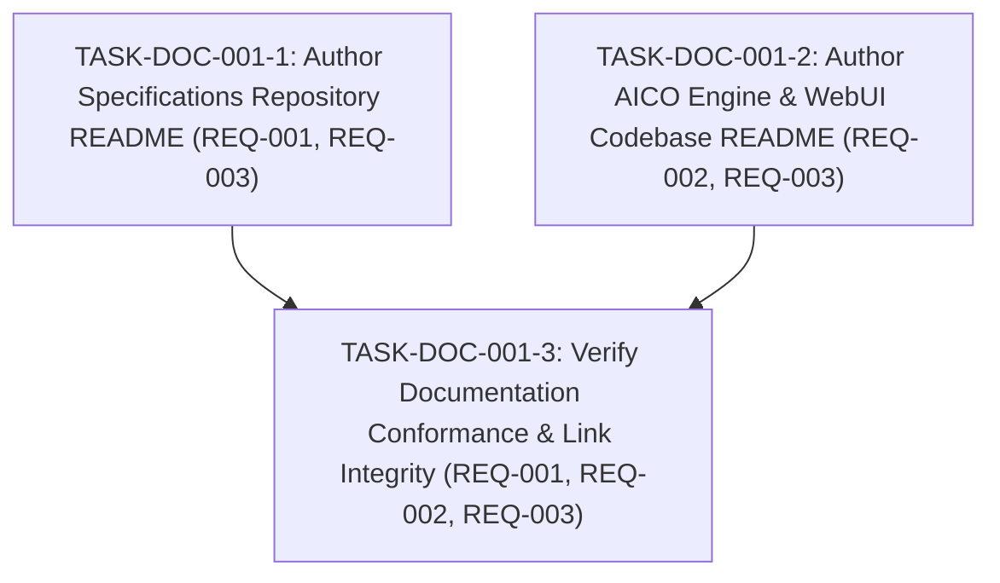

# Implementation Plan: Repository Readme Documentation for Specs and Codebase Repositories

## 1. Technical Architecture & Decisions

- **Target Repositories**: `aico-specs` and `aico` (engine codebase).
- **Documentation Grammar & Style**:
  - Follow the clear, modular structure exemplified in `codebase/aico-skills/README.md`.
  - Use GitHub Flavored Markdown alerts, tables, Mermaid architecture diagrams, and syntax-highlighted code blocks.
  - Strict adherence to Blueprint v0.1.2 relative linking (no machine-specific `file:///` paths).
- **`aico-specs/README.md` Architectural Coverage**:
  - Project identity & vision: Canonical SDD platform source of truth.
  - Decoupled multi-repo architecture (`.aico-project.json`).
  - Active Epics catalog (`ec-core`, `ec-git`, `ec-specs`, `ec-storage`, `ec-terminal`, `ec-tooling`).
  - Strict 4-phase sequence & Blueprint v0.1.2 rules.
  - Automated verification via `verify-artifacts.mjs`.
- **`codebase/aico/README.md` Architectural Coverage**:
  - Engine overview: Zero-daemon local-first SDD runtime daemon.
  - Rust workspace breakdown (5 crates: `aico-core`, `aico-security`, `aico-storage`, `aico-mcp`, `aico-server`).
  - React 19 / TypeScript / Vite / Tailwind v4 WebUI capabilities.
  - Prerequisites, compilation (`cargo build -p aico-server`), test execution (`cargo test`, `npm test`), and live daemon execution on port `4242`.
  - Bidirectional code-to-spec traceability conventions (`@implements` / `@verifies`).

---

## 2. Task Graph (DAG)

### Phase 1: Specifications Repository Documentation

- **TASK-DOC-001-1**: Author Specifications Repository README
  - **Status**: Done
  - **Addresses**: `REQ-001`, `REQ-003`
  - **Blocked by**: None
  - **What it delivers**:
    - Creates `d:/aico/aico-specs/README.md`.
    - Documents decoupled SDD architecture, directory structure, 6 engineering epics, Blueprint v0.1.2 standards, EARS syntax, and verification instructions.
  - **Verification Seam**: `node .agents/skills/aico-verify/scripts/verify-artifacts.mjs d:/aico/aico-specs`

---

### Phase 2: Codebase Engine & WebUI Documentation

- **TASK-DOC-001-2**: Author AICO Engine & WebUI Codebase README
  - **Status**: Done
  - **Addresses**: `REQ-002`, `REQ-003`
  - **Blocked by**: None
  - **What it delivers**:
    - Creates `d:/aico/codebase/aico/README.md`.
    - Documents multi-crate Rust workspace architecture, React 19 WebUI, build/test workflows, daemon startup commands, and `@implements` / `@verifies` traceability rules.
  - **Verification Seam**: Link checking and markdown linting.

---

### Phase 3: Verification & Quality Gate

- **TASK-DOC-001-3**: Verify Documentation Conformance & Link Integrity
  - **Status**: Done
  - **Addresses**: `REQ-001`, `REQ-002`, `REQ-003`
  - **Blocked by**: `TASK-DOC-001-1`, `TASK-DOC-001-2`
  - **What it delivers**:
    - Runs `verify-artifacts.mjs` ensuring 100% Blueprint v0.1.2 compliance and zero broken relative links.
    - Updates task status to `Done` and plan/spec status to `Completed`.
    - Stages, commits, and pushes changes across both repositories.
  - **Verification Seam**: `node .agents/skills/aico-verify/scripts/verify-artifacts.mjs d:/aico/aico-specs`

---

## 3. Amendment Log

- **2026-10-25T19:35:00Z**: Initialized standalone feature specification and implementation plan for authoring `README.md` documents across `aico-specs` and `codebase/aico`.
